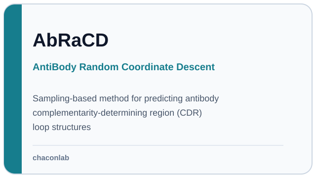
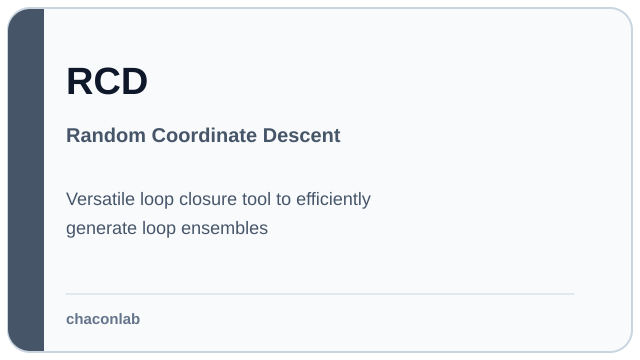

# Iván Martín Hernández

## Computational scientist · Structural Bioinformatics

---

## 📊 GitHub activity

  
  

---

## 🧬 Selected projects

  
  

---

## 📚 Publications, talks & posters

### Journal articles

1. Martín-Hernández I, Dehouck Y, Bastolla U, López-Blanco JR, Chacón P. Predicting protein stability changes upon mutation using a simple orientational potential. *Bioinformatics*. 2023;39(1):btad011. [📄](./documents/publications/KORPM.pdf "Open local PDF") · [🔗](https://doi.org/10.1093/bioinformatics/btad011 "Open DOI")

2. Martín-Hernández I, Pagán I. Gene overlapping as a modulator of begomovirus evolution. *Microorganisms*. 2022;10(2):366. [📄](./documents/publications/GeneOverlaping.pdf "Open local PDF") · [🔗](https://doi.org/10.3390/microorganisms10020366 "Open DOI")

3. Beal J, Farny NG, Haddock-Angelli T, et al. Robust estimation of bacterial cell count from optical density. *Communications Biology*. 2020;3(1):512. [📄](./documents/publications/RobustBacteria.pdf "Open local PDF") · [🔗](https://doi.org/10.1038/s42003-020-01127-5 "Open DOI")

### Other research output

Grootveld M, Leenarts E, von Stein I, et al. Workshop report “Training in the EOSC”. 2020. [🔗](https://doi.org/10.5281/zenodo.3894370 "Open DOI")

### Manuscript submitted

Martín-Hernández I, Chacón P, López-Blanco JR. AbRaCD: Fast sampling-based prediction of antibody CDR loops. *Bioinformatics Advances*. 2026. Submitted.

### Conferences & posters

1. Martín-Hernández I, López-Blanco JR, Chacón P. Improving protein loop modelling for antibody H3-CDR loops [poster]. VPhDay Biología UCM; 2021.

2. Martín-Hernández I, López-Blanco JR, Chacón P. Improving protein loop modelling for antibody H3-CDR loops. In: *Congress Book of the 7th International Iberian Biophysics Congress*; 2021. ISBN: 978-989-33-2042-6.

3. Martín-Hernández I, López-Blanco JR, Chacón P. Improving loop modeling prediction [abstract]. In: *Abstracts of the JOINT 12th EBSA Congress and 10th ICBP-IUPAP Congress*; 2019 Jul 20–24; Madrid, Spain. *European Biophysics Journal*. 2019. [🔗](https://doi.org/10.1007/s00249-019-01373-4 "Open DOI")

4. Madrid-OLM. Internet of Biothings [team project]. *iGEM 2018 Giant Jamboree*; 2018 Oct; Boston, MA, USA. [Wiki](https://2018.igem.org/Team:Madrid-OLM) · [News](https://www.inmunotek.com/igem-madrid-galardonado-igem-2018-boston/)
